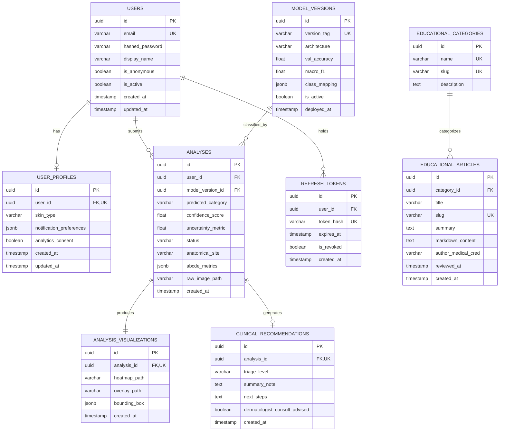

# DermaVision AI — Database Design & Entity Relationship Specification

**Database Engine:** PostgreSQL 15+  
**ORM Framework:** SQLAlchemy 2.0 (Asyncpg) + Alembic Migrations

---

## 1. Entity-Relationship (ER) Diagram

---

## 2. Table Schemas & DDL Specifications

### 2.1 `users`
| Column | Type | Constraints | Description |
| :--- | :--- | :--- | :--- |
| `id` | `UUID` | `PRIMARY KEY, DEFAULT gen_random_uuid()` | Unique user identifier |
| `email` | `VARCHAR(255)` | `UNIQUE, NOT NULL` | Verified login email |
| `hashed_password`| `VARCHAR(255)` | `NOT NULL` | bcrypt password digest |
| `display_name` | `VARCHAR(100)` | `NULLABLE` | Optional screen name |
| `is_anonymous` | `BOOLEAN` | `DEFAULT FALSE` | Flag for temporary demo sessions |
| `is_active` | `BOOLEAN` | `DEFAULT TRUE` | Soft-disable flag |
| `created_at` | `TIMESTAMPTZ` | `DEFAULT NOW()` | Registration timestamp |
| `updated_at` | `TIMESTAMPTZ` | `DEFAULT NOW()` | Record modification timestamp |

### 2.2 `analyses`
| Column | Type | Constraints | Description |
| :--- | :--- | :--- | :--- |
| `id` | `UUID` | `PRIMARY KEY, DEFAULT gen_random_uuid()` | Unique analysis scan identifier |
| `user_id` | `UUID` | `FOREIGN KEY (users.id) ON DELETE CASCADE` | Associated user account |
| `model_version_id`| `UUID` | `FOREIGN KEY (model_versions.id)` | Exact neural architecture version |
| `predicted_category`| `VARCHAR(50)` | `NOT NULL` | Acne, Eczema, Normal, or Inconclusive |
| `confidence_score`| `FLOAT` | `NOT NULL` | Calibrated probability ($0.0 \le p \le 1.0$) |
| `uncertainty_metric`| `FLOAT` | `NOT NULL` | Entropy / variance score |
| `status` | `VARCHAR(30)` | `NOT NULL` | `COMPLETED`, `UNCERTAIN`, `FAILED_QUALITY` |
| `anatomical_site`| `VARCHAR(50)` | `DEFAULT 'Unspecified'` | Face, Forearm, Neck, Torso, etc. |
| `abcde_metrics` | `JSONB` | `DEFAULT '{}'` | Asymmetry, Border, Color, Diameter |
| `raw_image_path` | `VARCHAR(512)` | `NOT NULL` | Secure internal storage URI |
| `created_at` | `TIMESTAMPTZ` | `DEFAULT NOW()` | Scan execution timestamp |

*Index:* `CREATE INDEX idx_analyses_user_created ON analyses (user_id, created_at DESC);`

### 2.3 `analysis_visualizations`
| Column | Type | Constraints | Description |
| :--- | :--- | :--- | :--- |
| `id` | `UUID` | `PRIMARY KEY, DEFAULT gen_random_uuid()` | Visualization identifier |
| `analysis_id` | `UUID` | `FOREIGN KEY (analyses.id) ON DELETE CASCADE, UNIQUE` | 1-to-1 link to analysis record |
| `heatmap_path` | `VARCHAR(512)` | `NOT NULL` | Raw normalized Grad-CAM matrix/image |
| `overlay_path` | `VARCHAR(512)` | `NOT NULL` | Blended Jet/Plasma overlay image URI |
| `bounding_box` | `JSONB` | `NULLABLE` | Detected skin lesion crop coordinates |
| `created_at` | `TIMESTAMPTZ` | `DEFAULT NOW()` | Creation timestamp |

### 2.4 `model_versions`
| Column | Type | Constraints | Description |
| :--- | :--- | :--- | :--- |
| `id` | `UUID` | `PRIMARY KEY, DEFAULT gen_random_uuid()` | Model release identifier |
| `version_tag` | `VARCHAR(50)` | `UNIQUE, NOT NULL` | e.g. `mobilenet_v3_large_v1.0.0` |
| `architecture` | `VARCHAR(50)` | `NOT NULL` | `MobileNetV3`, `EfficientNetB0` |
| `val_accuracy` | `FLOAT` | `NOT NULL` | Top-1 validation accuracy |
| `macro_f1` | `FLOAT` | `NOT NULL` | Macro-averaged F1 score |
| `class_mapping` | `JSONB` | `NOT NULL` | `{"0": "Acne", "1": "Eczema", "2": "Normal"}` |
| `is_active` | `BOOLEAN` | `DEFAULT FALSE` | Routing flag for current inference |
| `deployed_at` | `TIMESTAMPTZ` | `DEFAULT NOW()` | Production deployment date |

---

## 3. Data Privacy & "Right to be Forgotten" Cascade

When a user triggers an account deletion (`DELETE /api/v1/users/me`):
1. **Database Cascade:** PostgreSQL foreign keys (`ON DELETE CASCADE`) automatically wipe all corresponding `analyses`, `analysis_visualizations`, and `clinical_recommendations`.
2. **Storage Purge Hook:** An asynchronous background cleanup task deletes all associated raw skin images, cropped tiles, heatmaps, and overlay images from private storage.
3. Zero residual biometrics or image artifacts remain on disk or database.
