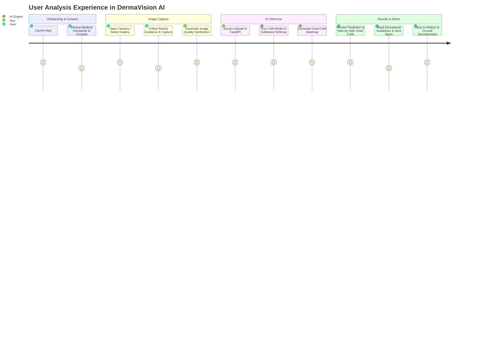

# DermaVision AI — Product Requirements Document (PRD)

**Version:** 1.0.0  
**Status:** Approved for Discovery  
**Author:** DermaVision AI Architecture Team  
**Target Platform:** Mobile-First (Android & iOS via React Native / Expo)

---

## 1. Executive Summary & Vision

### 1.1 Product Vision
**DermaVision AI** is a mobile-first, privacy-respecting healthcare awareness application designed to empower smartphone users with instant, preliminary, AI-assisted visual skin screening, calibrated confidence ratings, explainable AI visual heatmaps (Grad-CAM), and verified educational guidance.

> **CRITICAL MEDICAL DISCLAIMER:**  
> DermaVision AI is strictly an **educational and preliminary screening tool**. It does **NOT** provide medical diagnoses, prescribe treatment, or replace certified dermatologists. All predictions are explicitly communicated as probabilistic pattern similarities intended to guide informed healthcare consultations.

### 1.2 Target Audience & User Personas
1. **Primary Smartphone User (Ages 18–35):** Students and working professionals noticing an irregular rash, acne flare-up, or changing mole who need quick, understandable, non-alarmist clarity on when to seek professional care.
2. **Skin-Health Proactive Individual:** Users tracking recurring conditions (e.g., eczema or acne) over time across body locations.
3. **Underserved / Remote User:** Individuals in regions with long dermatological wait times (often 3–6 months) who need objective documentation and triage guidance to present to a general practitioner.

---

## 2. Core Functional Requirements

### 2.1 User Authentication & Session Management
- **Email/Password Auth:** Standard JWT-based sign up, login, and secure password reset.
- **Anonymous / Guest Demo Mode:** First-time users can test image analysis immediately without mandatory account creation; data remains local until account conversion.
- **Biometric Lock (Optional):** Biometric/PIN unlock for app launch to protect sensitive bodily photos.
- **Account & Data Lifecycle:** One-click complete account deletion ("Right to be Forgotten") with automatic hard deletion of all stored images and database records.

### 2.2 Camera Integration & Guided Capture
- **Hardware Interface:** Integration with device camera via Expo Camera / Native Camera API with flash controls, macro focus guidance, and real-time orientation level.
- **Dynamic Framing Reticle:** Visual viewport overlay prompting the user to keep the skin lesion centered and perpendicular at an optimal 10–15 cm distance.
- **Gallery Import:** Ability to pick existing photographs with automated EXIF orientation normalization.
- **Interactive Cropping & Adjustment:** Pinch-to-zoom and square boundary selector to isolate the region of interest (ROI) prior to inference.

### 2.3 Pre-Inference Image Quality Validation (Gatekeeper Engine)
Before sending the photograph to the deep learning classifier, a lightweight validation module enforces:
1. **Resolution Check:** Minimum dimension $\ge 512 \times 512$ pixels.
2. **Blur Detection (Laplacian Variance):** Rejects blurred images ($Var(Laplacian) < \tau_{blur}$, default threshold 100).
3. **Lighting / Exposure Check:** Computes histogram luminance; flags severe underexposure (mean pixel intensity $< 40$) or washed-out overexposure ($> 225$).
4. **Color & Contrast Check:** Validates that dynamic range is sufficient to distinguish skin texture.
5. **Human Skin Presence Heuristic:** Verifies HSV/YCbCr color space skin-tone distribution before running deep inference to avoid arbitrary predictions on random objects.

*If validation fails, the app politely halts and presents actionable guidance (e.g., "Image is too blurry. Please steady your phone and turn on flash.") rather than serving unreliable predictions.*

### 2.4 Educational Classification Categories (MVP Scope)
The initial production model is rigorously trained and benchmarked on three core categories:
1. **Acne (Acne Vulgaris / Inflammatory & Comedonal)**
2. **Eczema (Atopic Dermatitis / Contact Dermatitis)**
3. **Normal / Benign Baseline Skin**

*Architecture Extensibility:* The taxonomy and model head are architected with configurable class registries to easily incorporate Melanocytic Nevi, Seborrheic Keratosis, Psoriasis, and Rosacea in subsequent releases.

### 2.5 Explainable AI (XAI) via Grad-CAM
- **Visual Attention Map:** Visualizes the specific convolutional feature map activations from the final layer that led to the prediction.
- **Bilateral Dual-View:** Interactive side-by-side or slider comparison between the raw original skin photo and the Grad-CAM jet/plasma heatmap overlay.
- **Transparency Copy:** Clear microcopy explaining: *"The highlighted region indicates where the AI focused its visual analysis; it does not demarcate exact diseased margins."*

### 2.6 Calibrated Confidence & "Unable to Classify" State
- **Temperature Scaling & Softmax Calibration:** Raw logits are calibrated so reported percentages reflect true empirical likelihoods.
- **Uncertainty Rejection Threshold:** If the maximum prediction confidence is $< 60\%$, or the entropy across classes exceeds safe thresholds, the app explicitly reports: **"Inconclusive / Unable to Confidently Classify"** and advises manual dermatological review.

### 2.7 Analysis History & Longitudinal Tracking
- Local SQLite / remote cloud encrypted sync of past scans.
- Categorized by date, anatomical location, and condition.
- User can view full historical cards, compare visual changes, export clinical summaries as PDF, or delete individual records.

### 2.8 Educational Knowledge Hub
- Medically reviewed reference guides for Acne, Eczema, Sun Protection, and General Epidermal Wellness.
- "When to see a Doctor" triage decision tree (e.g., rapid bleeding, spreading erythema, systemic fever).
- Misconception busters (e.g., debunking harsh DIY skincare remedies).

---

## 3. Non-Functional Requirements (NFRs)

| Category | Requirement | Metric / Target |
| :--- | :--- | :--- |
| **Inference Latency** | End-to-end time from upload to Grad-CAM result | $< 2.0\text{ seconds}$ on 4G/WiFi |
| **API Availability** | Backend uptime SLA | $\ge 99.9\%$ |
| **App Bundle Size** | Mobile app install footprint | $< 35\text{ MB}$ |
| **Security** | In-transit and at-rest encryption | TLS 1.3 / AES-256 for private object storage |
| **Privacy** | Ephemeral or consent-driven retention | Uploaded images deleted within 24h unless user opts into History Sync |
| **Accessibility** | Inclusive mobile usability | WCAG 2.1 AA compliant, 48dp minimum touch targets, dynamic font scaling |

---

## 4. User Journey Map

