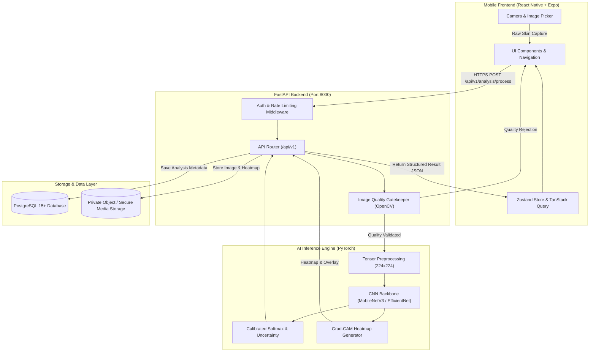
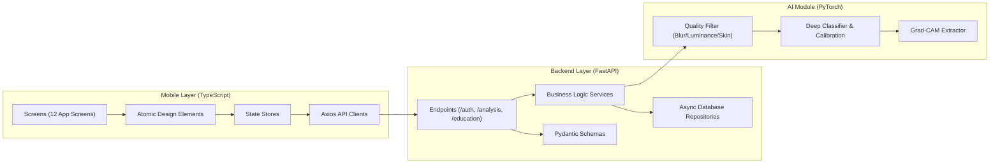
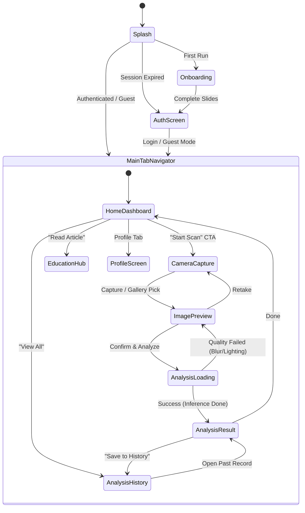
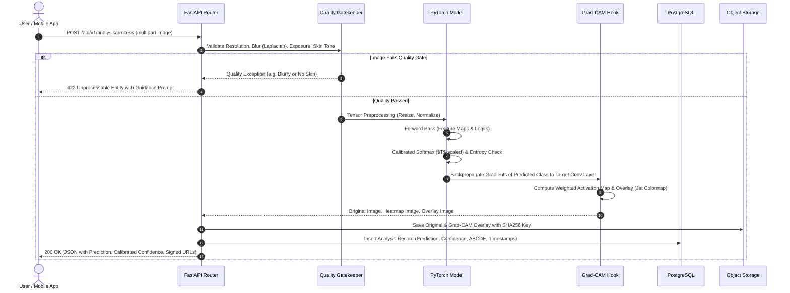

# DermaVision AI — System Architecture Specification

**Version:** 1.0.0  
**Status:** Approved for Implementation

---

## 1. High-Level System Architecture

The following diagram illustrates the relationship between the mobile client, API gateway, backend services, AI inference pipeline, database, and private storage.

---

## 2. Component Architecture

---

## 3. Mobile Navigation Flow Diagram

---

## 4. AI Inference Workflow

---

## 5. Deployment Architecture

```mermaid
flowchart TD
    subgraph ClientDevices["Client Devices"]
        Android["Android Device (APK / AAB)"]
        iOS["iOS Device (TestFlight / IPA)"]
    end

    subgraph Ingress["Ingress / Reverse Proxy"]
        Nginx["Nginx / Caddy (SSL Termination, Rate Limiting)"]
    end

    subgraph AppCluster["Application Container Cluster"]
        FastAPI_1["FastAPI Worker 1 (Uvicorn)"]
        FastAPI_2["FastAPI Worker 2 (Uvicorn)"]
        PyTorch_CPU["PyTorch Inference Module (Shared Weights)"]
    end

    subgraph DataCluster["Data & Persistence Services"]
        PG[("PostgreSQL 15 Container")]
        Volume[("Encrypted Media Volume / S3 Bucket")]
    end

    Android -->|"HTTPS"| Nginx
    iOS -->|"HTTPS"| Nginx
    Nginx --> FastAPI_1
    Nginx --> FastAPI_2
    FastAPI_1 --> PyTorch_CPU
    FastAPI_2 --> PyTorch_CPU
    FastAPI_1 --> PG
    FastAPI_2 --> PG
    FastAPI_1 --> Volume
    FastAPI_2 --> Volume
```

